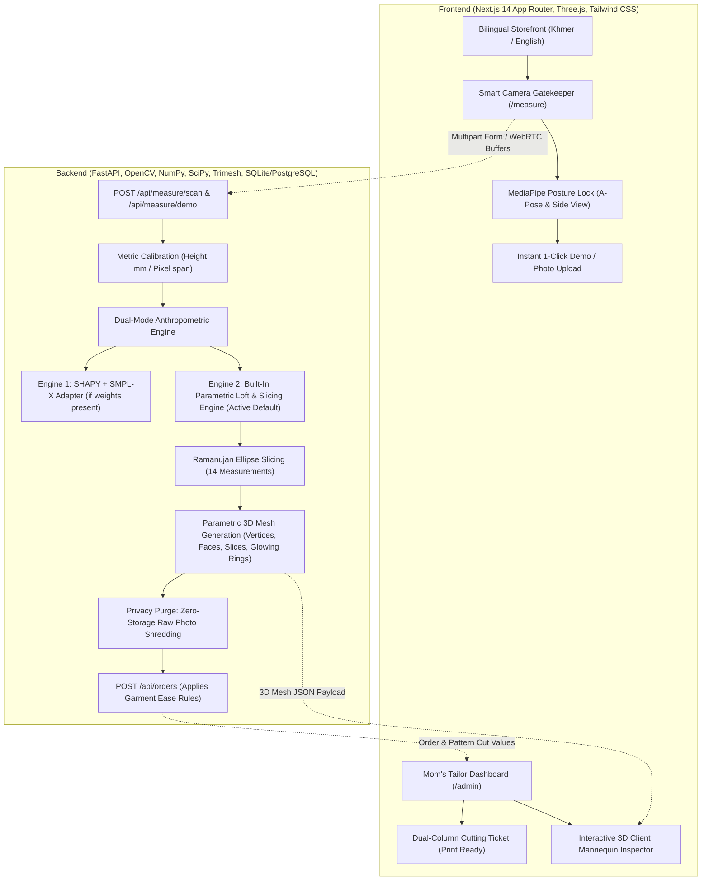

# ApsaraFit (ហាងកាត់ដេរបុរាណម៉ាក់ និងស្ទូឌីយោវាស់កាត់ 3D AI)
### Mom's Traditional Tailor Shop & AI 3D Fitting Studio

A bespoke, production-ready, full-stack web application designed for a traditional Cambodian master tailoring atelier. The platform enables remote customers across the globe to browse heritage garments, undergo a guided precision front-and-side posture scan via their smartphone or laptop camera, reconstruct their 3D body proportions with millimeter accuracy, and generate a dual-column **Master Tailor Cutting Ticket** (with fabric ease rules applied) sent directly to the cutting room.

---

## 🏛️ System Architecture



---

## 🚀 Key Modules & Engineering Features

### 1. Module A: Bilingual Storefront & Traditional Garment Catalog (`/`)
- **Global Bilingual Context (`LanguageContext`):** Complete Khmer (`ភាសាខ្មែរ`) and English (`EN`) localization with tailoring-grade terminology (Shoulder Width, Bust, Under-bust, Waist, High Hip, Low Hip, Armhole Depth, Bicep, Sleeve Length, Back Neck-to-Waist, Inseam).
- **6 Showcase Heritage Garments:**
  1. **Av Pak (Traditional Khmer Lace/Silk Blouse)** - Non-stretch raw silk bodice (+30 mm bust, +20 mm waist, +15 mm bicep ease).
  2. **Sampot Hol / Sampot Chang Kben** - Multi-colored ikat wrap and pleated ceremony garment.
  3. **Full Traditional Bridal / Ceremony Ensemble** - Upper + lower formal bespoke set with gold Sbong sash.
  4. **Bespoke Silk Evening Dress** - Contemporary Takeo province gala gown.
  5. **Men's Traditional Mandarin Collar Silk Jacket (Av Koko)** - Structured canvas chest interlining and hand-wrapped silk buttons.
  6. **Custom Tailored Trousers / Formal Slacks** - High-rise dress slacks with tapered or straight break.

### 2. Module B: Hands-Free 360° Guided Turnaround Scan (`/measure`)
- **Apple Face ID-Style Full-Body Experience:** Completely hands-free operation once the customer steps into the camera frame.
- **On-Screen Visual Stencil & 360° Circular Radar Ring:**
  - High-precision translucent SVG human body guide stencil in the center of the camera viewport.
  - 8-sector **360° Circular Radar Progress Ring** (`0° Front`, `45° Front-Right`, `90° Right Side`, `135° Back-Right`, `180° Back`, `225° Back-Left`, `270° Left Side`, `315° Front-Left`) with an active orientation needle and digital yaw degrees readout.
- **Phase 1: Step-In & Alignment Lock:**
  - Detects full body presence (head to heels) within the stencil frame and checks camera levelness.
  - Holds stable for 1.5 seconds, then triggers an audible Web Audio chime sequence and automatically transitions to Phase 2.
- **Phase 2: Real-Time Yaw Tracking & Auto-Capture:**
  - Computes body rotation yaw in real time from shoulder/hip spatial vectors.
  - Enforces low angular velocity ($< 45^\circ/\text{s}$) to avoid motion blur.
  - As the user slowly spins in place and enters each of the 8 sectors ($\pm 12^\circ$ tolerance), it automatically snaps a high-res frame, marks that sector **Green** on the radar, and plays an ascending musical feedback beep so the user hears their progress even when facing away at $180^\circ$.
  - Once all 8 sectors are captured, plays a completion arpeggio and auto-submits the multi-angle bundle to the backend!
- **1-Click "Simulate 360° Turnaround Scan" Button:**
  - Instantly animates the 360° yaw spin, fills each sector on the radar with audio chimes, and sends the 8-angle bundle for 3D reconstruction without needing to stand up.

### 3. Module C: Hybrid 3D Anthropometric & Millimeter Measurement Engine
- **Engine Mode 1 (`smplx_engine.py`):** Loads SMPL-X / SHAPY PyTorch checkpoints if present in `/backend/models/smplx/`, deforms template mesh, and slices planes using `trimesh.intersections.mesh_plane`.
- **Engine Mode 2 (`anthropometry.py` - Active Default):**
  - Binary silhouette segmentation using bilateral filtering, adaptive Gaussian thresholding, and morphological opening/closing.
  - Metric calibration: $\text{mm\_per\_pixel} = \frac{\text{height\_mm}}{y_{\text{heel}} - y_{\text{crown}}}$.
  - Horizontal slicing of Front width ($2a$) and Side depth ($2b$) at 14 anatomical landmark ratios.
  - **Ramanujan's First Approximation for Ellipse Perimeter:**
    $$C = \pi \left[ 3(a + b) - \sqrt{(3a + b)(a + 3b)} \right]$$
  - Generates 14 tailoring measurements (mm, cm, and inches).
  - Lofts 50 horizontal cross-sections into a 3D parametric humanoid mesh with vertices, triangular faces, and glowing ring metadata.
  - **Privacy-First Photo Auto-Delete:** Immediately deletes and garbage-collects raw image buffers before returning response.

### 4. Module D: Mom's Tailor Dashboard & Printable Cutting Ticket (`/admin`)
- **Orders Queue:** Real-time list of customer orders with filter by status (`PENDING_REVIEW`, `IN_CUTTING`, `SEWING`, `COMPLETED`).
- **Dual-Column Tailor Cutting Card (Khmer + English):**
  - Column 1: Measurement Name (`ទទឹងស្មា / Shoulder Width`)
  - Column 2: Exact Body Skin Measurement (`cm` / `mm`)
  - Column 3: Fabric Ease Rule (interactive per-row adjuster, e.g. `+3.0 cm`)
  - Column 4: Final Pattern Cut Measurement (`cm` and bold `inches` for the tailor's tape measure)
  - One-click **Print Tailor Ticket** button with clean `@media print` layout.
- **Interactive 3D Client Mannequin Inspector:**
  - Embedded Three.js / React Three Fiber viewport.
  - Clicking any measurement table row illuminates that exact glowing ring on the 3D mannequin!

---

## 🏃 Quick Start Guide

### Option 1: Local Development (Fastest Zero-Config Startup)

#### 1. Activate Python Virtual Environment & Start Backend (Port 8000)
```powershell
# In root directory:
$env:PYTHONPATH="backend"
.\venv\Scripts\python.exe -m uvicorn app.main:app --host 127.0.0.1 --port 8000
```

#### 2. Start Next.js Frontend (Port 3000)
```powershell
# In another terminal:
cd frontend
npm start
# Or for live hot-reload development:
npm run dev
```

Open your browser at:
- **Customer Storefront:** [http://localhost:3000](http://localhost:3000)
- **AI 3D Scan Wizard:** [http://localhost:3000/measure](http://localhost:3000/measure)
- **Mom's Tailor Dashboard:** [http://localhost:3000/admin](http://localhost:3000/admin)
- **FastAPI Interactive Docs:** [http://127.0.0.1:8000/docs](http://127.0.0.1:8000/docs)

---

### Option 2: Full Docker Container Orchestration

Run all services (Frontend, Backend, and PostgreSQL) via Docker Compose:
```bash
docker compose up --build
```
- Frontend: `http://localhost:3000`
- Backend API: `http://localhost:8000`
- PostgreSQL: `localhost:5432`

---

## 🧪 Testing the Pipeline in 10 Seconds

1. Go to [http://localhost:3000/measure](http://localhost:3000/measure).
2. Click **"Run 1-Click Demo Scan"** at the top or on Step 1.
3. Observe the AI engine synthesize the anatomical proportions, compute the Ramanujan perimeter ellipses, and render the interactive 3D client mannequin with glowing measurement rings.
4. Fill in customer name/phone and click **"Generate Tailor Ticket & Send Order"**.
5. Switch to [http://localhost:3000/admin](http://localhost:3000/admin) to inspect the newly received order, click measurement rows to illuminate rings, adjust fabric ease rules, and click **"Print Tailor Ticket"**.
